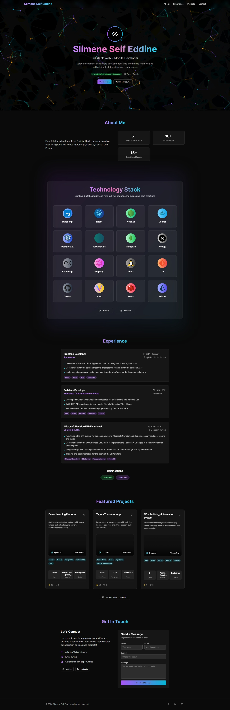

# 🌌 Taleb Hatem – Cosmic Portfolio

## 🚀 Overview

Welcome to my personal **developer portfolio**, built with [v0.dev](https://v0.dev) and deployed via **Vercel**.  
This portfolio showcases my:

- 🧠 Technical skills (Full Stack, CTFs, and Cloud)
- 👨‍💻 Featured projects
- 📈 Learning journey (CTF + Networking path)
- 📬 Contact section powered by **Next.js API + Nodemailer**

> This repo is **automatically synced** with changes made via [v0.dev](https://v0.dev), and redeployed through Vercel.

---

## 🔗 Live Portfolio

👉 [https://seifeddineslimene.com](https://v4.seifeddineslimene.com)

---

## 🛠 Tech Stack

- **Framework:** Next.js (App Router)
- **Styling:** TailwindCSS
- **Components:** shadcn/ui
- **Email:** Nodemailer + Gmail SMTP
- **Deployment:** Vercel
- **Design Tool:** [v0.dev](https://v0.dev)

---

## 🧠 How It Works

1. 🎨 Build + edit UI with [v0.dev](https://v0.dev/chat/projects/Yf6D7yGxiAY)
2. 🧩 Customize the logic & backend in this repo
3. 🔁 Changes are synced & pushed automatically from v0.dev
4. 🚀 Vercel deploys latest updates instantly

---

## 🤝 Connect With Me

- GitHub: [@hatem12345th](https://github.com/hatem12345th)
- Email: h.taleb@esi-sba.dz

---

## Run the project

nvm use
npm install -g pnpm
pnpm -v
pnpm install
pnpm approve-builds
pnpm install
pnpm dev

> Built with ❤️ by Taleb Hatem
